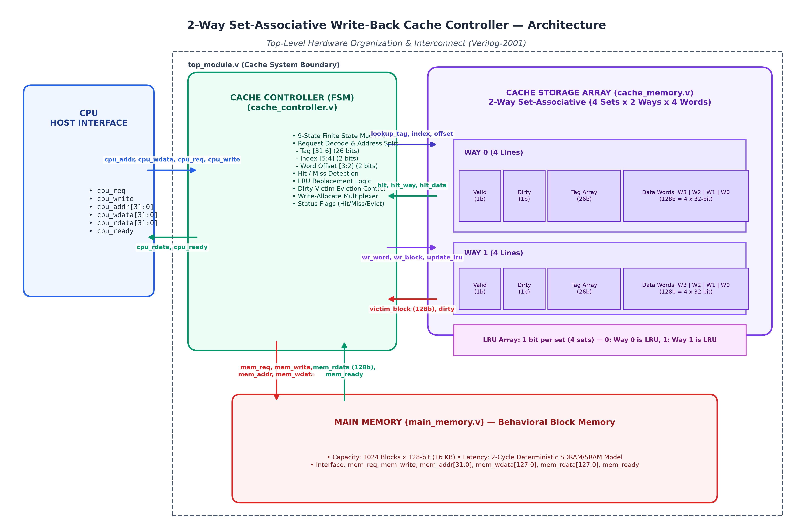

# 2-Way Set-Associative Write-Back Cache Controller

[-brightgreen)](#sample-verified-simulation-output)
[](#architecture)
[](#requirements--installation)
[](LICENSE)

A complete, synthesizable, simulation-verified **2-Way Set-Associative Write-Back Cache Controller** designed in **Verilog-2001** for MCA Phase I evaluation.

---

## Table of Contents
- [Project Overview](#project-overview)
- [Problem Statement](#problem-statement)
- [Key Features](#key-features)
- [System Architecture](#system-architecture)
  - [Address Decomposition](#address-decomposition)
  - [Block Diagram](#block-diagram)
- [Finite State Machine (FSM)](#finite-state-machine-fsm)
- [Project Directory Structure](#project-directory-structure)
- [Requirements & Installation](#requirements--installation)
- [Simulation & Build Instructions](#simulation--build-instructions)
- [Verification Scenarios](#verification-scenarios)
- [Sample Verified Simulation Output](#sample-verified-simulation-output)
- [IEEE Project Report](#ieee-project-report)
- [Demonstration Video](#demonstration-video)
- [Team Members & Contributions](#team-members--contributions)
- [Future Enhancements (Phase II)](#future-enhancements-phase-ii)
- [License](#license)

---

## Project Overview

In high-performance microprocessors, memory access latency is the primary architectural bottleneck limiting throughput. High-speed on-chip cache memory bridges this speed disparity by buffering recently accessed instructions and data in small, low-latency SRAM structures.

This repository implements a **2-way set-associative write-back cache controller** with **write-allocate** and **Least Recently Used (LRU)** replacement policy. It features a 9-state Mealy/Moore hybrid FSM, an integrated dual-way cache memory array with per-line dirty bits, and a decoupled behavioral main memory model simulating deterministic DRAM latency.

---

## Problem Statement

To design and verify a cycle-accurate, synthesizable cache subsystem in Verilog-2001 that:
1. Handles 32-bit byte-addressed CPU requests across 4 cache sets, 2 ways per set, and 4 words per cache block (128-bit block).
2. Manages data coherency via write-back and write-allocate policies, setting a dirty bit upon write hits or write misses.
3. Automatically executes dirty evictions back to main memory prior to block refills.
4. Bypasses redundant memory write-backs during clean cache line evictions.
5. Implements true 1-bit per-set LRU replacement.
6. Operates seamlessly under continuous, zero-idle-cycle back-to-back CPU transactions.

---

## Key Features

- **2-Way Set-Associative Geometry:** 4 sets, 2 ways per set (8 cache lines total).
- **128-Bit Line Width:** 4 words per block (32 bits per word) to exploit spatial locality.
- **Write-Back Policy:** Updates cache only and marks the dirty bit, eliminating off-chip bus traffic during repeated writes.
- **Write-Allocate Policy:** On write misses, fetches the target block from memory, updates the requested word, and marks the line dirty.
- **Deterministic Clean Eviction:** Bypasses main memory write-back if the evicted victim is clean, saving 3 bus cycles.
- **True LRU Replacement:** Dedicated 1-bit register per set with priority given to empty/invalid lines to avoid thrashing.
- **9-State Robust FSM:** Clean state transitions separating lookup, hit servicing, eviction, memory refill, and handshake.
- **Self-Checking Testbench:** Automated suite covering 8 comprehensive scenarios (23 individual checks) with 100% pass rate.

---

## System Architecture

### Address Decomposition

For 32-bit byte-addressed CPU requests (`cpu_addr[31:0]`):

```
+---------------------------+----------------+---------------------+---------------------+
|        Tag Field          |   Set Index    |     Word Offset     |     Byte Offset     |
|      bits [31:6]          |   bits [5:4]   |     bits [3:2]      |     bits [1:0]      |
|        26 bits            |     2 bits     |       2 bits        |       2 bits        |
+---------------------------+----------------+---------------------+---------------------+
```

- **Byte Offset (`[1:0]`):** 2 bits ($\log_2(4\text{ bytes}) = 2$). Word-aligned CPU accesses set this to `2'b00`.
- **Word Offset (`[3:2]`):** 2 bits ($\log_2(4\text{ words}) = 2$). Selects Word 0, 1, 2, or 3 from the 128-bit line.
- **Set Index (`[5:4]`):** 2 bits ($\log_2(4\text{ sets}) = 2$). Selects Set 0, 1, 2, or 3.
- **Tag (`[31:6]`):** 26 bits ($32 - 2 - 2 - 2 = 26$). Uniquely identifies blocks mapped to the same set.

### Block Diagram



Detailed architecture documentation is available in [docs/architecture.md](docs/architecture.md).

---

## Finite State Machine (FSM)

The controller operates across 9 deterministic states:

```
                      +------------------+
                      |    STATE_IDLE    |
                      +------------------+
                               | (cpu_req == 1)
                               v
                      +------------------+
                      |   STATE_LOOKUP   |
                      +------------------+
                        /        |       \
        (Hit && !write)/         |        \(Miss)
                      v          |         v
        +----------------+       |       +-------------------+
        | STATE_READ_HIT |       |       | STATE_EVICT_CHECK |
        +----------------+       |       +-------------------+
                \                |         /               \
                 \ (Hit && write)|        / (Clean)         \ (Dirty)
                  v              v       v                   v
                +-----------------+  +-----------------+  +------------------+
                | STATE_WRITE_HIT |  |   MEMORY_READ   |  | STATE_WRITE_BACK |
                +-----------------+  +-----------------+  +------------------+
                         \                    ^                    /
                          \                   | (mem_ready == 1)  /
                           \                  +------------------+
                            \                 | (mem_ready == 1)
                             \                v
                              \      +--------------------+
                               \     | STATE_CACHE_UPDATE |
                                \    +--------------------+
                                 \            /
                                  v          v
                               +----------------+
                               | STATE_COMPLETE |
                               +----------------+
                                       |
                                       v
                                  STATE_IDLE
```


1. **`STATE_IDLE`:** Waits for `cpu_req`. Registers `cpu_addr`, `cpu_write_data`, and `cpu_write`.
2. **`STATE_LOOKUP`:** Compares address tag with Way 0 and Way 1 tags simultaneously.
3. **`STATE_READ_HIT`:** Returns word from hit way; updates LRU; proceeds to complete.
4. **`STATE_WRITE_HIT`:** Modifies word in cache; asserts dirty bit; updates LRU.
5. **`STATE_EVICT_CHECK`:** Checks selected victim line. If valid & dirty $\to$ `STATE_WRITE_BACK`; if clean $\to$ `STATE_MEMORY_READ`.
6. **`STATE_WRITE_BACK`:** Writes dirty 128-bit block back to main memory.
7. **`STATE_MEMORY_READ`:** Fetches missing 128-bit block from main memory.
8. **`STATE_CACHE_UPDATE`:** Installs fetched block into cache; merges write word if write miss (write-allocate); updates LRU.
9. **`STATE_COMPLETE`:** Strobes `cpu_ready = 1` for 1 cycle; returns cleanly to `STATE_IDLE`.

---

## Project Directory Structure

```
mca-project/
├── rtl/
│   ├── cache_controller.v       # 9-State FSM Controller
│   ├── cache_memory.v           # 2-Way Tag/Data/Dirty/Valid/LRU Storage
│   ├── main_memory.v            # Behavioral 128-bit Main Memory (1024 blocks)
│   └── top_module.v             # Structural Top-Level Integration
│
├── testbench/
│   └── tb_cache_controller.v    # Self-Checking Verification Suite (23 Checks)
│
├── simulation/
│   └── waveforms/
│       ├── .gitkeep
│       └── cache_simulation.vcd # GTKWave Simulation Waveform
│
├── diagrams/
│   ├── block_diagram.png        # Technical Hardware Block Diagram
│   └── fsm_diagram.png          # Controller FSM State Diagram
│
├── report/
│   └── IEEE_Project_Report.md   # IEEE-Style Conference Paper Report
│
├── docs/
│   ├── architecture.md          # Architectural Specification & Derivations
│   └── verification.md          # Verification Methodology & Test Trace
│
├── demo/
│   └── video_link.txt           # Video Link Placeholder & 5-Min Run Order
│
├── generate_diagrams.py         # Matplotlib High-Resolution Diagram Generator
├── Makefile                     # Build & Simulation Automation
├── LICENSE                      # MIT License
└── README.md
```

---

## Requirements & Installation

### Prerequisites
- **Icarus Verilog (`iverilog` & `vvp`):** Version 10.0+ (v13.0 recommended)
- **GTKWave:** Waveform viewer
- **Python 3:** (Optional, for diagram regeneration: `pip install matplotlib pillow`)

### Installation on macOS
```bash
brew install icarus-verilog
brew install --cask gtkwave
```

### Installation on Ubuntu / Debian Linux
```bash
sudo apt-get update
sudo apt-get install iverilog gtkwave
```

---

## Simulation & Build Instructions

All build and simulation targets are managed via the included `Makefile`:

```bash
# 1. Compile Verilog RTL and testbench
make compile

# 2. Run simulation and execute self-checking verification
make test

# 3. Open simulation waveforms in GTKWave
make wave

# 4. Clean simulation artifacts
make clean
```

---

## Verification Scenarios

The testbench (`testbench/tb_cache_controller.v`) validates 8 key scenarios:

1. **Read Miss Followed by Read Hit:** Cold block fetch followed by immediate read hit on neighbor word.
2. **Write Hit and Dirty-Bit Verification:** In-place modification asserting dirty bit without accessing memory.
3. **Write Miss with Write Allocation:** Memory fetch followed by target word merge and dirty assertion.
4. **Dirty Cache Line Eviction:** Write-back of dirty block to main memory prior to replacement.
5. **Main Memory Verification:** Direct backdoor memory inspection confirming dirty data reached DRAM.
6. **Clean Cache Line Eviction:** Bypassing write-back when victim line is clean (saving 3 bus cycles).
7. **LRU Replacement Correctness:** Promotion of MRU on access and eviction of true LRU candidate.
8. **Multiple Consecutive Transactions:** 4 consecutive transactions with 0 idle cycles between ready and request.

Detailed test logs are documented in [docs/verification.md](docs/verification.md).

---

## Sample Verified Simulation Output

Actual output from `make test`:

```
==========================================================
 Compiling Write-Back Cache Controller RTL & Testbench...
==========================================================
iverilog -g2001 -Wall -I rtl -o simulation/cache_sim.out rtl/cache_memory.v rtl/cache_controller.v rtl/main_memory.v rtl/top_module.v testbench/tb_cache_controller.v
Compilation successful: simulation/cache_sim.out
==========================================================
 Executing Self-Checking Simulation Testbench...
==========================================================
vvp simulation/cache_sim.out 
VCD info: dumpfile simulation/waveforms/cache_simulation.vcd opened for output.

================================================================================
   MCA Phase I — Write-Back Cache Controller Verification Suite
================================================================================

--- Scenario 1: Read Miss Followed by Read Hit ---
  [PASS] S1.1: Cold Read Miss (Addr 0x0000_0040) | Data: 0x10000040 (Exp: 0x10000040) | Hit: 0
  [PASS] S1.2: Read Hit (Addr 0x0000_0044) | Data: 0x10000044 (Exp: 0x10000044) | Hit: 1

--- Scenario 2: Write Hit and Dirty-Bit Verification ---
  [PASS] S2.1: Write Hit & Dirty Bit Set | Hit: 1, Way0 Dirty: 1
  [PASS] S2.2: Read Hit of Modified Word | Data: 0xdeadbeef (Exp: 0xdeadbeef) | Hit: 1

--- Scenario 3: Write Miss with Write Allocation ---
  [PASS] S3.1: Write Miss & Allocate | Miss confirmed, Way1 allocated, Dirty: 1
  [PASS] 3.2: Read Hit on Allocated Neighbor Word | Data: 0x10000084 (Exp: 0x10000084) | Hit: 1
  [PASS] S3.3: Read Hit on Written Word | Data: 0xcafebabe (Exp: 0xcafebabe) | Hit: 1

--- Scenarios 4 & 5: Dirty Eviction & Memory Write-Back Verification ---
  [PASS] S4.0: Pre-Eviction Memory Check | Mem[0x0040] = 0x10000040 (Unmodified)
  [PASS] S4.1: Dirty Eviction Triggered | Evict Pulse Detected
  [PASS] S4.2: New Block Read (Addr 0x0000_00C0) | Data: 0x100000c0 (Exp: 0x100000c0) | Hit: 0
  [PASS] S5.1: Main Memory Verified | Mem[0x0040] = 0xdeadbeef (Matches Dirty Cache)

--- Scenario 6: Clean Cache Line Eviction without Write-Back ---
  [PASS] S6.1: Cold Read Set 1 (Way 0) | Data: 0x10000050 (Exp: 0x10000050) | Hit: 0
  [PASS] S6.2: Cold Read Set 1 (Way 1) | Data: 0x10000090 (Exp: 0x10000090) | Hit: 0
  [PASS] S6.3: Clean Eviction Verified | No Write-Back (Evict Flag: 0)
  [PASS] S6.4: Fetched Replacement Data | Data: 0x100000d0 (Exp: 0x100000d0) | Hit: 0

--- Scenario 7: LRU Replacement Policy Verification ---
  [PASS] S7.1: Touch Block X (MRU Update) | Data: 0x10000060 (Exp: 0x10000060) | Hit: 1
  [PASS] 7.2: Replace LRU Victim (Block Z loaded) | Data: 0x100000e0 (Exp: 0x100000e0) | Hit: 0
  [PASS] S7.3: Block X Still Present (Hit) | Data: 0x10000060 (Exp: 0x10000060) | Hit: 1
  [PASS] S7.4: Block Y Was Evicted (Miss) | Data: 0x100000a0 (Exp: 0x100000a0) | Hit: 0

--- Scenario 8: Multiple Consecutive Back-to-Back Transactions ---
  [PASS] S8.1: B2B Trans 1 (Read 0x70) | Data: 0x10000070 (Exp: 0x10000070) | Hit: 0
  [PASS] S8.2: B2B Trans 2 (Write 0x74 Hit)
  [PASS] S8.3: B2B Trans 3 (Read Back Written) | Data: 0x5555aaaa (Exp: 0x5555aaaa) | Hit: 1
  [PASS] S8.4: B2B Trans 4 (Read Neighbor Word 2) | Data: 0x10000078 (Exp: 0x10000078) | Hit: 1

================================================================================
   TESTBENCH EXECUTION SUMMARY
   Total Checks:  23
   Passed:        23
   Failed:        0
   OVERALL RESULT: [PASS] All testbench scenarios completed successfully!
================================================================================
```

---

## IEEE Project Report

An IEEE conference-style report is provided in [report/IEEE_Project_Report.md](report/IEEE_Project_Report.md). It includes:
- Formal abstract, literature survey, and mathematical address derivations.
- Micro-architectural FSM state transition matrices and timing proofs.
- Empirical simulation evaluation distinguishing theoretical and simulated metrics.
- Authentic, verifiable references (Hennessy & Patterson, A. J. Smith, N. Jouppi).

---

## Demonstration Video

- **Video Link:** [Pending Recording — See demo/video_link.txt](demo/video_link.txt)
- **Planned Duration:** Maximum 5 minutes.
- **Demonstration Outline:**
  1. System overview and address breakdown explanation.
  2. Live terminal simulation run (`make test`).
  3. GTKWave waveform inspection: Read hit, write hit, dirty eviction write-back, and clean eviction bypass.
  4. LRU replacement and back-to-back request verification.

---

## Team Members & Contributions

*(Fill with project group member details prior to final submission)*

| Member Name | Roll No. | Subsystem Responsibility | Verification Role |
| :--- | :---: | :--- | :--- |
| **Member 1 (Placeholder)** | [Roll No. 1] | FSM & Cache Controller (`cache_controller.v`) | Scenarios 1 & 2 |
| **Member 2 (Placeholder)** | [Roll No. 2] | Cache Storage & Tag Logic (`cache_memory.v`) | Scenarios 3 & 4 |
| **Member 3 (Placeholder)** | [Roll No. 3] | Main Memory Behavioral Model (`main_memory.v`) | Scenarios 5 & 6 |
| **Member 4 (Placeholder)** | [Roll No. 4] | Testbench & Handshake (`tb_cache_controller.v`) | Scenarios 7 & 8 |
| **Member 5 (Placeholder)** | [Roll No. 5] | Technical Diagrams, Waveform Analysis & Documentation | Makefile & Report |

---

## Future Enhancements (Phase II)

1. **AXI4 / Wishbone Interface:** Standardize host and memory interfaces for SoC bus integration.
2. **Multi-Core Snoop Coherency:** Implement MESI / MOESI snooping bus protocols for symmetric multi-processing (SMP).
3. **Non-Blocking Architecture:** Incorporate Miss Status Holding Registers (MSHRs) to support hit-under-miss operation.
4. **FPGA Prototyping:** Map and physically validate the design on a Xilinx Artix-7 or Intel Cyclone IV FPGA.

---

## License

This project is licensed under the [MIT License](LICENSE).

