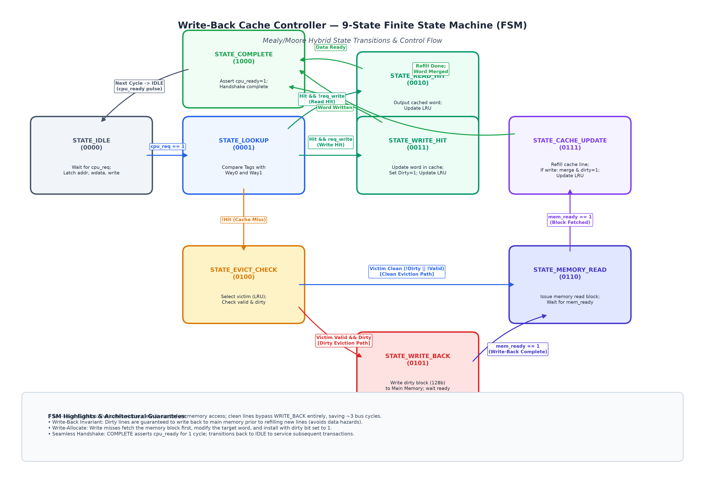

# Write-Back Cache Controller

[-brightgreen)](#sample-verified-simulation-output)
[](#architecture)
[](#requirements--installation)
[](LICENSE)

A complete, synthesizable, simulation-verified **Write-Back Cache Controller** designed in **Verilog-2001** for MCA Phase I evaluation.

---

## Table of Contents
- [Project Overview](#project-overview)
- [Problem Statement](#problem-statement)
- [Project Objectives](#project-objectives)
- [Key Features](#key-features)
- [System Architecture](#system-architecture)
  - [Address Decomposition](#address-decomposition)
  - [Block Diagram](#block-diagram)
- [Write-Back Policy & Dirty-Bit Management](#write-back-policy--dirty-bit-management)
- [Finite State Machine (FSM)](#finite-state-machine-fsm)
- [Verilog Module Descriptions](#verilog-module-descriptions)
- [Project Directory Structure](#project-directory-structure)
- [Requirements & Installation](#requirements--installation)
- [Simulation & Build Instructions](#simulation--build-instructions)
- [Verification Scenarios](#verification-scenarios)
- [Sample Verified Simulation Output](#sample-verified-simulation-output)
- [Project Report](#project-report)
- [Prototype Demonstration Video](#prototype-demonstration-video)
- [Team Members & Contributions](#team-members--contributions)
- [Future Enhancements (Phase II)](#future-enhancements-phase-ii)
- [License](#license)

---

## Project Overview

In high-performance microprocessors, memory access latency is the primary architectural bottleneck limiting throughput. High-speed on-chip cache memory bridges this speed disparity by buffering recently accessed instructions and data in low-latency SRAM structures.

This repository implements a **Write-Back Cache Controller** with **write-allocation** and per-line **dirty-bit management**. The underlying cache storage utilizes a direct-mapped organization (8 lines $\times$ 128 bits) as an educational, clean architecture that places central emphasis on the write-back mechanism, dirty-line tracking, and backing memory coherency. The subsystem features a 9-state Mealy/Moore hybrid FSM, an integrated cache memory array, and a decoupled behavioral main memory model simulating deterministic DRAM latency.

---

## Problem Statement

To design, implement in Verilog-2001, and verify via cycle-accurate simulation a robust, synthesizable **Write-Back Cache Controller** that:
1. Handles aligned 32-bit byte-addressed CPU read and write transactions (`cpu_addr[1:0] == 2'b00`).
2. Implements a direct-mapped cache organization with 4 words (128 bits) per cache line to exploit spatial locality.
3. Enforces the **write-back policy**, ensuring that write hits update only local cache storage and set the dirty bit while leaving backing main memory unmodified.
4. Implements the **write-allocate policy**, refilling memory blocks on write misses, modifying the target word, and marking the cache line dirty.
5. Guarantees data coherency during evictions: detects dirty cache lines, preserves their original address, and writes the full 128-bit block back to main memory prior to fetching the replacement block.
6. Bypasses unnecessary write-back operations when evicting clean lines, saving off-chip bus cycles.
7. Operates seamlessly under continuous, zero-idle-cycle back-to-back CPU transactions.

---

## Project Objectives

1. **Architectural Specification:** Formulate a mathematically consistent address decomposition mapping 32-bit CPU addresses into Tag, Index, Word Offset, and Byte Offset fields.
2. **Modular RTL Design:** Structure the hardware into cohesive, synthesizable modules:
   - `cache_controller.v`: 9-state Mealy/Moore FSM and control sequencing.
   - `cache_memory.v`: Storage arrays for tags, valid bits, dirty bits, and data words.
   - `main_memory.v`: Behavioral 128-bit block memory with realistic multi-cycle DRAM latency.
   - `top_module.v`: Structural integration encapsulating all inter-module buses.
3. **Rigorous Verification Suite:** Develop an automated, self-checking testbench (`tb_cache_controller.v`) verifying twelve functional scenarios with programmatic assertions.
4. **Waveform and Signal Analysis:** Generate and inspect VCD waveforms in GTKWave to confirm cycle-accurate state transitions and bus protocols.

---

## Key Features

- **Direct-Mapped Cache Organization:** 8 cache lines, 4 words per line (128-bit line width, 128 bytes total data capacity).
- **Write-Back Policy:** Updates cache only and marks the dirty bit, eliminating off-chip bus traffic during repeated writes.
- **Write-Allocate Policy:** On write misses, fetches the target block from memory, updates the requested word, and marks the line dirty.
- **Dirty-Bit Management:** Dedicated hardware flag per line tracking modifications relative to backing storage.
- **Deterministic Clean Eviction:** Bypasses main memory write-back if the evicted line is clean, saving 3 bus cycles.
- **Coherent Dirty Eviction:** Writes the full 128-bit dirty block back to its original memory address before refilling.
- **9-State Robust FSM:** Clean state transitions separating lookup, hit servicing, eviction, memory refill, and handshake.
- **Self-Checking Testbench:** Automated suite covering 12 comprehensive scenarios with 19 programmed assertion checks (19/19 checks passed).

---

## System Architecture

### Address Decomposition

For 32-bit byte-addressed CPU requests (`cpu_addr[31:0]`):

```
+---------------------------+----------------+---------------------+---------------------+
|        Tag Field          |   Line Index   |     Word Offset     |     Byte Offset     |
|      bits [31:7]          |   bits [6:4]   |     bits [3:2]      |     bits [1:0]      |
|        25 bits            |     3 bits     |       2 bits        |       2 bits        |
+---------------------------+----------------+---------------------+---------------------+
```

- **Byte Offset (`[1:0]`):** 2 bits ($\log_2(4\text{ bytes}) = 2$). Word-aligned CPU accesses set this to `2'b00`.
- **Word Offset (`[3:2]`):** 2 bits ($\log_2(4\text{ words}) = 2$). Selects Word 0, 1, 2, or 3 from the 128-bit line.
- **Line Index (`[6:4]`):** 3 bits ($\log_2(8\text{ lines}) = 3$). Selects one of the 8 cache lines ($0$ to $7$).
- **Tag (`[31:7]`):** 25 bits ($32 - 3 - 2 - 2 = 25$). Uniquely identifies resident blocks mapped to each line.

### Block Diagram


Detailed architecture documentation is available in [docs/architecture.md](docs/architecture.md).

---

## Write-Back Policy & Dirty-Bit Management

1. **Write Hit:** Data is written to the cache line; the line's dirty bit is set to `1'b1`. Main memory is **not** written, preserving bus bandwidth.
2. **Write Miss (Write-Allocate):** The required memory block is fetched, the target word is modified with write data, and the line is installed in cache with `dirty = 1'b1`.
3. **Dirty Eviction:** If a conflicting access targets a line that is valid and dirty (`valid == 1 && dirty == 1`), the controller writes the full 128-bit block back to its original address before loading the new block.
4. **Clean Eviction Bypass:** If the resident line is clean (`dirty == 0`), the write-back step is completely bypassed, saving memory latency.

---

## Finite State Machine (FSM)

The controller operates across 9 deterministic states:

```
                      +------------------+
                      |    STATE_IDLE    |
                      +------------------+
                               | (cpu_req == 1)
                               v
                      +------------------+
                      |   STATE_LOOKUP   |
                      +------------------+
                        /        |       \
        (Hit && !write)/         |        \(Miss)
                      v          |         v
        +----------------+       |       +-------------------+
        | STATE_READ_HIT |       |       | STATE_EVICT_CHECK |
        +----------------+       |       +-------------------+
                \                |         /               \
                 \ (Hit && write)|        / (Clean)         \ (Dirty)
                  v              v       v                   v
                +-----------------+  +-----------------+  +------------------+
                | STATE_WRITE_HIT |  |   MEMORY_READ   |  | STATE_WRITE_BACK |
                +-----------------+  +-----------------+  +------------------+
                         \                    ^                    /
                          \                   | (mem_ready == 1)  /
                           \                  +------------------+
                            \                 | (mem_ready == 1)
                             \                v
                              \      +--------------------+
                               \     | STATE_CACHE_UPDATE |
                                \    +--------------------+
                                 \            /
                                  v          v
                               +----------------+
                               | STATE_COMPLETE |
                               +----------------+
                                       |
                                       v
                                  STATE_IDLE
```



1. **`STATE_IDLE`:** Waits for `cpu_req`. Registers `cpu_addr`, `cpu_write_data`, and `cpu_write`.
2. **`STATE_LOOKUP`:** Evaluates `cache_hit = valid[index] && (tag[index] == req_tag)`.
3. **`STATE_READ_HIT`:** Returns word from cache line; completes request.
4. **`STATE_WRITE_HIT`:** Modifies word in cache; asserts dirty bit (`dirty = 1'b1`); memory untouched.
5. **`STATE_EVICT_CHECK`:** Checks resident line. If valid & dirty $\to$ `STATE_WRITE_BACK`; if clean $\to$ `STATE_MEMORY_READ`.
6. **`STATE_WRITE_BACK`:** Writes dirty 128-bit block back to original memory address.
7. **`STATE_MEMORY_READ`:** Fetches missing 128-bit block from main memory.
8. **`STATE_CACHE_UPDATE`:** Installs fetched block into cache; merges write word if write miss (write-allocate).
9. **`STATE_COMPLETE`:** Strobes `cpu_ready = 1` for 1 cycle; returns cleanly to `STATE_IDLE`.

---

## Verilog Module Descriptions

| Module | File | Functional Responsibility |
| :--- | :--- | :--- |
| **`cache_controller`** | [`rtl/cache_controller.v`](rtl/cache_controller.v) | 9-state FSM, hit/miss detection, dirty eviction, write-allocate |
| **`cache_memory`** | [`rtl/cache_memory.v`](rtl/cache_memory.v) | Direct-mapped storage (8 lines), valid/dirty bits, tag/data arrays |
| **`main_memory`** | [`rtl/main_memory.v`](rtl/main_memory.v) | Behavioral 128-bit block memory (1,024 blocks), 2-cycle latency model |
| **`top_module`** | [`rtl/top_module.v`](rtl/top_module.v) | Structural top integration interconnecting CPU, cache, and memory |
| **`tb_cache_controller`**| [`testbench/tb_cache_controller.v`](testbench/tb_cache_controller.v) | Self-checking testbench (12 scenarios, 19 assertions) |

### Behavioral Main Memory Subsystem & Simulation Scope

- **Storage Structure:** The backing memory model (`rtl/main_memory.v`) provides 1,024 blocks of 128 bits each (16 KB total storage) with configurable 2-cycle latency to emulate physical memory timing.
- **Address Selection:** Blocks are indexed using address bits `[13:4]` (10 bits), covering byte addresses `0x0000_0000` through `0x0000_3FFF`.
- **Simulation Modeling Boundary:** Addresses with identical `[13:4]` bit patterns map to the same simulated block location. This abstraction avoids multi-megabyte simulation overhead while providing cycle-accurate latency modeling for functional verification.
- **Simulation Verification Boundary:** The cache controller and cache memory are written using standard synthesizable Verilog-2001 constructs. However, physical FPGA/ASIC synthesis, place-and-route, and hardware validation have not been performed in Phase I; all reported results reflect cycle-accurate RTL simulation in Icarus Verilog.

---

## Project Directory Structure

```
mca-project/
├── rtl/
│   ├── cache_controller.v       # 9-State FSM Controller
│   ├── cache_memory.v           # Direct-Mapped Cache Storage Array
│   ├── main_memory.v            # Behavioral 128-bit Main Memory (1024 blocks)
│   └── top_module.v             # Structural Top-Level Integration
│
├── testbench/
│   └── tb_cache_controller.v    # Self-Checking Verification Suite (19 Checks)
│
├── simulation/
│   └── waveforms/
│       ├── .gitkeep
│       └── cache_simulation.vcd # GTKWave Simulation Waveform
│
├── diagrams/
│   ├── block_diagram.png        # Technical Hardware Block Diagram
│   └── fsm_diagram.png          # Controller FSM State Diagram
│
├── report/
│   ├── IEEE_Project_Report.pdf  # Finalized IEEE-Style Project Report (PDF)
│   └── IEEE_Project_Report.md   # IEEE-Style Conference Paper Report (Markdown)
│
├── docs/
│   ├── architecture.md          # Architectural Specification & Derivations
│   └── verification.md          # Verification Methodology & Test Trace
│
├── generate_diagrams.py         # Matplotlib High-Resolution Diagram Generator
├── Makefile                     # Build & Simulation Automation
├── LICENSE                      # MIT License
└── README.md
```

---

## Requirements & Installation

### Prerequisites
- **Icarus Verilog (`iverilog` & `vvp`):** Version 10.0+ (v13.0 recommended)
- **GTKWave:** Waveform viewer
- **Python 3:** (Optional, for diagram regeneration: `pip install matplotlib pillow`)

### Installation on macOS
```bash
brew install icarus-verilog
brew install --cask gtkwave
```

### Installation on Ubuntu / Debian Linux
```bash
sudo apt-get update
sudo apt-get install iverilog gtkwave
```

---

## Simulation & Build Instructions

All build and simulation targets are managed via the included `Makefile`:

```bash
# 1. Compile Verilog RTL and testbench
make compile

# 2. Run simulation and execute self-checking verification
make test

# 3. Open simulation waveforms in GTKWave
make wave

# 4. Clean simulation artifacts
make clean
```

---

## Verification Scenarios

The testbench (`testbench/tb_cache_controller.v`) validates 12 key scenarios:

1. **Cold Read Miss:** Cold block fetch from main memory, line installation, valid bit set.
2. **Read Hit After Refill:** Immediate read hit on resident block without memory access.
3. **Write Hit:** In-place modification of cached word.
4. **Dirty-Bit Setting:** Verifying dirty bit is asserted upon write hit.
5. **Main Memory Unchanged (Write-Back Proof):** Proving main memory is NOT modified during a write hit.
6. **Write Miss with Write Allocation:** Memory fetch followed by target word merge and dirty assertion.
7. **Dirty Cache Line Eviction:** Detecting conflicting access to dirty line and asserting eviction pulse.
8. **Main Memory Write-Back Verification:** Proving modified dirty block reaches backing memory.
9. **Memory Refill Verification:** Verifying new block is refilled and marked clean.
10. **Clean Eviction Bypass:** Bypassing write-back when victim line is clean (saving 3 bus cycles).
11. **Reading Previously Written-Back Data:** Reading evicted block to prove end-to-end coherency.
12. **Multiple Consecutive Transactions:** 4 consecutive transactions with 0 idle cycles between ready and request.

Detailed test logs are documented in [docs/verification.md](docs/verification.md).

---

## Sample Verified Simulation Output

Actual output from `make test`:

```
==========================================================
 Compiling Write-Back Cache Controller RTL & Testbench...
==========================================================
iverilog -g2001 -Wall -I rtl -o simulation/cache_sim.out rtl/cache_memory.v rtl/cache_controller.v rtl/main_memory.v rtl/top_module.v testbench/tb_cache_controller.v
Compilation successful: simulation/cache_sim.out
==========================================================
 Executing Self-Checking Simulation Testbench...
==========================================================
vvp simulation/cache_sim.out
VCD info: dumpfile simulation/waveforms/cache_simulation.vcd opened for output.

================================================================================
   Write-Back Cache Controller — Comprehensive Verification Suite
================================================================================

--- Test 1: Cold Read Miss ---
  [PASS] T1.1: Cold Read Miss (Addr 0x0000_0090) | Data: 0x10000090 (Exp: 0x10000090) | Hit: 0

--- Test 2: Read Hit After Refill ---
  [PASS] Read Hit on Resident Block (Addr 0x0000_0094) | Data: 0x10000094 (Exp: 0x10000094) | Hit: 1

--- Tests 3 & 4: Write Hit & Dirty-Bit Verification ---
  [PASS] T3.1: Write Hit Confirmed & Dirty Bit Set | Line 1 Dirty: 1
  [PASS] T4.1: Read Hit of Modified Word | Data: 0xdeadbeef (Exp: 0xdeadbeef) | Hit: 1

--- Test 5: Main Memory Unchanged Verification (Write-Back Proof) ---
  [PASS] T5.1: Memory Unchanged | Mem[0x0090] = 0x10000090 (Proves Write-Back Policy)

--- Test 6: Write Miss with Write Allocation ---
  [PASS] T6.1: Write Miss & Allocate | Miss confirmed, Line 2 allocated, Dirty: 1
  [PASS] T6.2: Read Hit on Allocated Neighbor Word | Data: 0x100000a4 (Exp: 0x100000a4) | Hit: 1
  [PASS] T6.3: Read Hit on Written Word | Data: 0xcafebabe (Exp: 0xcafebabe) | Hit: 1

--- Tests 7 & 8: Dirty Eviction & Memory Write-Back Verification ---
  [PASS] T7.1: Dirty Eviction Detected | Evict Pulse Asserted on Conflict
  [PASS] T8.1: Main Memory Verified | Mem[0x0090] = 0xdeadbeef (Matches Written-Back Data)

--- Test 9: Memory Refill Verification ---
  [PASS] T9.1: Replacement Block Data Read | Data: 0x10000110 (Exp: 0x10000110) | Hit: 0
  [PASS] T9.2: Refilled Line Status | Valid: 1, Dirty: 0 (Clean Refill)

--- Test 10: Clean Eviction Without Write-Back ---
  [PASS] T10.1: Clean Eviction Verified | Write-Back Bypassed (Evict Flag: 0)
  [PASS] T10.2: Clean Replacement Fetched Data | Data: 0x10000190 (Exp: 0x10000190) | Hit: 0

--- Test 11: Reading Previously Written-Back Data ---
  [PASS] T11.1: Read Evicted Block from Memory | Data: 0xdeadbeef (Exp: 0xdeadbeef) | Hit: 0

--- Test 12: Multiple Consecutive Back-to-Back Transactions ---
  [PASS] T12.1: B2B Trans 1 (Read Miss 0x30) | Data: 0x10000030 (Exp: 0x10000030) | Hit: 0
  [PASS] T12.2: B2B Trans 2 (Write Hit 0x34)
  [PASS] T12.3: B2B Trans 3 (Read Back Written) | Data: 0x5555aaaa (Exp: 0x5555aaaa) | Hit: 1
  [PASS] T12.4: B2B Trans 4 (Read Neighbor Word 2) | Data: 0x10000038 (Exp: 0x10000038) | Hit: 1

================================================================================
   TESTBENCH EXECUTION SUMMARY
   Total Checks:  19
   Passed:        19
   Failed:        0
   OVERALL RESULT: [PASS] All Write-Back Cache Controller scenarios passed!
================================================================================
```

---

## Project Report

The complete IEEE-style project report is available in both formatted PDF and Markdown versions:

- [Download IEEE Project Report](report/IEEE_Project_Report.pdf)
- [View Markdown Report](report/IEEE_Project_Report.md)

### Key Sections:
- Formal abstract, literature survey, and mathematical address derivations.
- Micro-architectural FSM state transition matrices and write-back proofs.
- Empirical simulation evaluation distinguishing theoretical expectations and actual results.
- Authentic, verifiable references (Hennessy & Patterson, A. J. Smith, N. Jouppi, M. D. Hill).

---

## Prototype Demonstration Video

The project demonstration video covers the team introduction, project overview, Write-Back Cache Controller architecture, Verilog implementation, and simulation results.

- **Maximum Duration:** 5 minutes.
- **Demonstration Outline:**
  1. Team and project introduction.
  2. Cache architecture and write-back policy.
  3. Verilog implementation.
  4. Live simulation and verification results.

[Watch the Prototype Demonstration](https://drive.google.com/drive/folders/1AMVk8foru5JsWtKMorlUfYZXp7iilGyc?usp=sharing)

---

## Team Members & Contributions

**Team:** MCA_Project_2024_D_Team2<br>
**Institution:** Rishihood University

Hrishabh Prajapati led the architecture design, prepared the diagrams, implemented and integrated the Verilog RTL, developed the testbench, and verified the design through simulation. Pratyush Parida finalized the IEEE project report, updated the architecture documentation and README, and documented the prototype demonstration. No technical contributions were reported for the other listed team members.

| Team Member | Roll No. | Subsystem Responsibility & Contribution |
| :--- | :---: | :--- |
| **Hrishabh Prajapati** | 2401020027 | Architecture and diagrams; Verilog RTL implementation and system integration; testbench development; simulation verification |
| **Jigyasu Kalyan** | 2401010201 | No technical contribution reported |
| **Pratyush Parida** | 2401010351 | IEEE report finalization, architecture documentation, README updates, and prototype demonstration documentation |
| **Preet Vardhan** | 2401010352 | No technical contribution reported |
| **Raghav Gupta** | 2401010365 | No technical contribution reported |

---

## Future Enhancements (Phase II)

1. **AXI4 / Wishbone Interface:** Standardize host and memory interfaces for SoC bus integration.
2. **Multi-Core Snoop Coherency:** Implement MESI / MOESI snooping bus protocols for symmetric multi-processing (SMP).
3. **Non-Blocking Architecture:** Incorporate Miss Status Holding Registers (MSHRs) to support hit-under-miss operation.
4. **FPGA Prototyping:** Map and physically validate the design on a Xilinx Artix-7 or Intel Cyclone IV FPGA.

---

## License

This project is licensed under the [MIT License](LICENSE).
